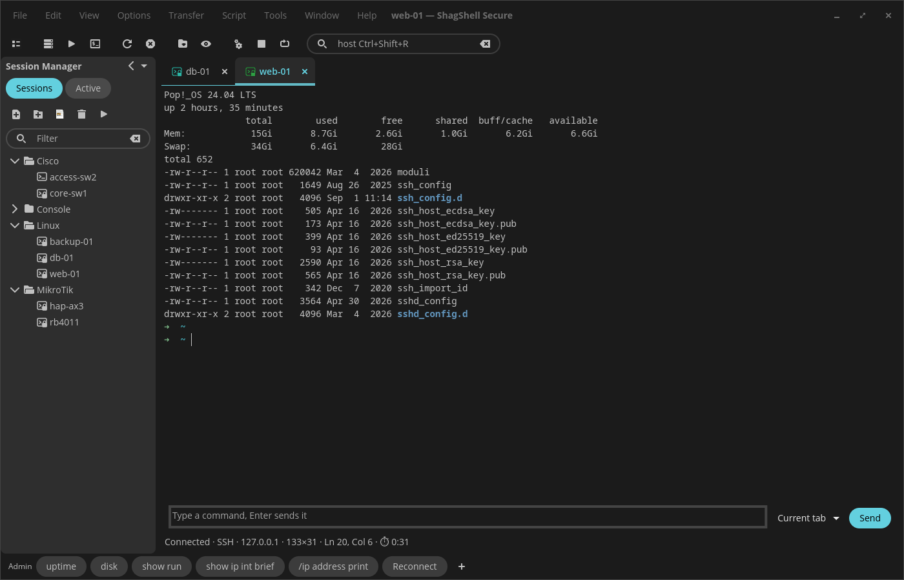
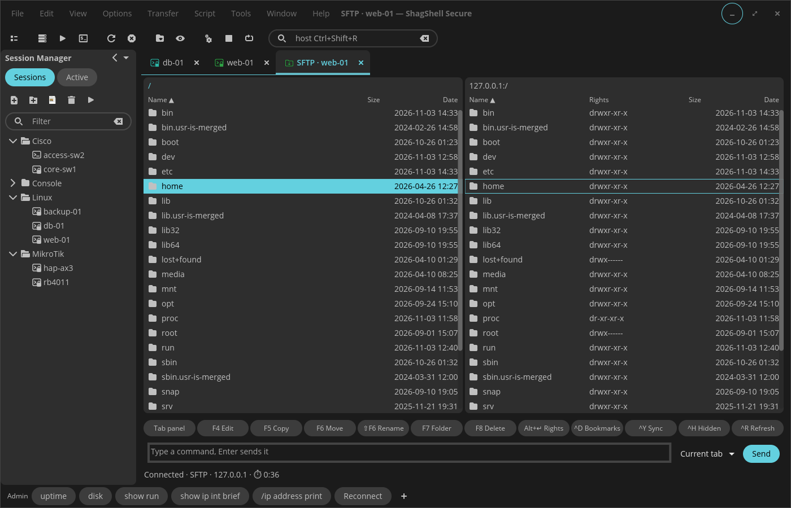
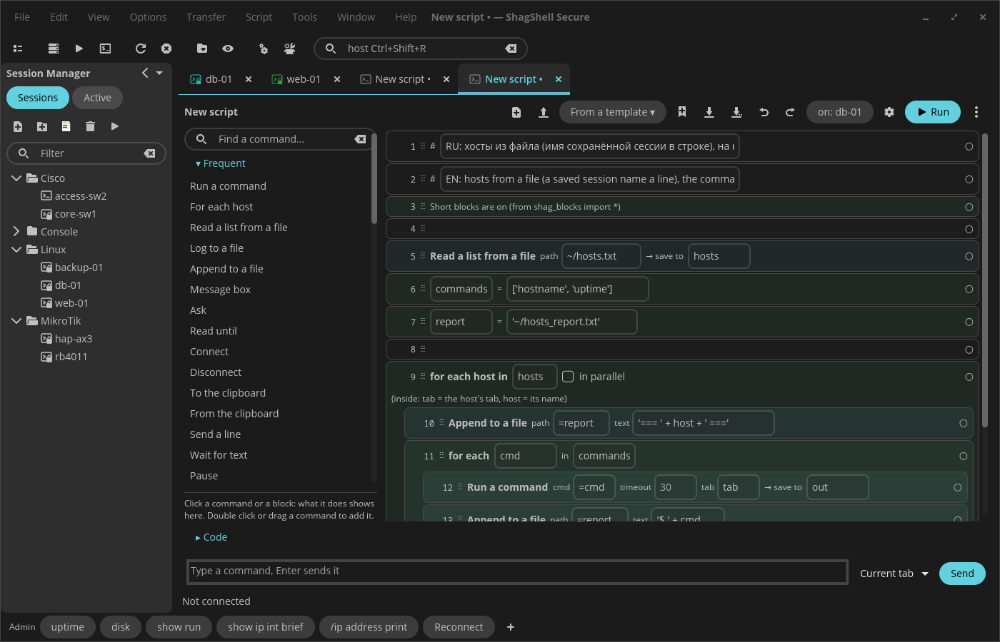
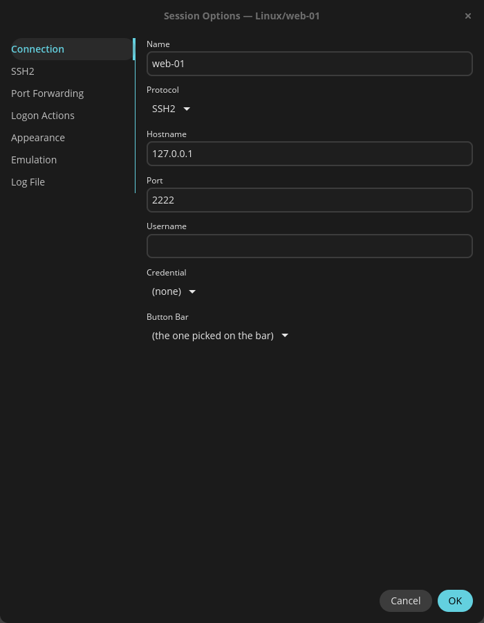

# ShagShell Secure

English | [Русский](README_ru.md)

An SSH / SFTP / Telnet / serial session manager for the COSMIC desktop (Pop!_OS 24.04), in the spirit of SecureCRT for Windows. Written in Rust on [libcosmic](https://github.com/pop-os/libcosmic). Made for Linux servers and network gear (Cisco, MikroTik, …).



**Status:** active development, used daily.

## Features

- **Session Manager** like SecureCRT's: a tree of folders and sessions, filter, drag to sort, an «Active» page with the open ones; Quick Connect (Alt+Q), Connect Bar (Ctrl+Shift+R), local shell (Ctrl+Shift+T)
- **The system OpenSSH under the hood**: `~/.ssh/config`, keys, the agent, jump hosts, port forwarding, ControlMaster (SFTP and cloned tabs reuse the connection) just work
- **Passwords and credential sets in the keyring** (Secret Service), never in files; host key and password prompts in the app's own dialogs
- **Tabs and tab groups** side by side, drag a tab between groups or into its own window, session groups opened at once
- **SFTP tab** in the SecureFX style: two panels, F5 copy / F6 move / F7 folder / F8 delete, a transfer queue with conflict answers, folder sync (Ctrl+Y), bookmarks, rights
- **Command Window**: type once, send to the current tab, a group or all tabs; multi-line input
- **Button Bar**: named bars of buttons that send a string, run a menu function, a program or a script; imported from SecureCRT
- **Telnet, serial** (picocom) and **X/Y/Zmodem** (lrzsz, Zmodem received by itself)
- **Logon Actions** (expect / send), keyword highlighting, colour schemes, key map, session logging by name templates
- **Python scripts** with a SecureCRT-like `crt` object (`crt.Screen.Send`, `WaitForString`, dialogs, `crt.FileTransfer`…), short blocks such as `run('show version')`, recording, a script console and debugging, a scheduler
- **Script Builder**: put a script together from blocks («For each host», «Run a command», «Append to a file»…), see the Python code, run it with each step highlighted
- **Import from SecureCRT**: sessions with their folders, Button Bar, Command Manager, colour schemes; `~/.ssh/config` hosts too
- Notes (`.md` tabs), SSH key generation and upload, signed updates, English and Russian

## A closer look

| | |
|---|---|
|  |  |
| SFTP tab: two panels, F-keys, queue, sync | Script Builder: blocks and the Python behind them |



Session Options, as in SecureCRT: Connection, SSH2, Port Forwarding, Logon Actions, Appearance, Emulation, Log File

## Keys

| | |
|---|---|
| Alt+M | Session Manager |
| Alt+C / Alt+Q | Connect… / Quick Connect |
| Alt+P | SFTP tab for the active session |
| Ctrl+Shift+R | Connect Bar: type a host or a session name |
| Ctrl+Shift+T | Local shell |
| Ctrl+Shift+M | Hide / show the menu bar |
| F4 / F5 / F6 / F7 / F8 | SFTP: edit / copy / move / new folder / delete |
| Ctrl+Y / Ctrl+D / Ctrl+H | SFTP: sync folders / bookmarks / hidden files |

Your own keys for strings, menu functions, programs and scripts: *Tools → Keymap Editor…*. Ctrl+Insert and Shift+Insert are left to the system.

## Install

### .deb (Pop!_OS 24.04, Ubuntu 24.04)

Download the latest release into the current folder, check it and install — copy the whole block, it needs nothing else (the files are fetched from this repository only):

```sh
B=https://github.com/shagovAlexei/cosmic-ext-shagshell-secure/releases/latest/download
curl -fLO $B/SHA256SUMS
curl -fLO $B/$(awk '{print $2}' SHA256SUMS)
sha256sum -c SHA256SUMS      # must print: shagshell_X.Y.Z_amd64.deb: OK
sudo apt install ./shagshell_*.deb
```

Doing it by hand from the [releases page](https://github.com/shagovAlexei/cosmic-ext-shagshell-secure/releases/latest)? Save **both** files (the `.deb` and `SHA256SUMS`) in the same folder and run `sha256sum -c SHA256SUMS` there; `No such file` means `SHA256SUMS` is not in the current folder.

The app checks for a newer release at startup (*Tools → Global Options… → Updates* to turn it off). An update is installed only if `SHA256SUMS` is signed with the author's key built into the app.

`shagshell --check` lists what it uses: `ssh`, `telnet`, `picocom`, `python3`, `sz` / `rz`, the keyring.

### Flatpak (COSMIC flatpak repository)

Being added to the [COSMIC flatpak repository](https://github.com/pop-os/cosmic-flatpak). Pop!_OS 24.04 has it; elsewhere add it first with `flatpak remote-add --if-not-exists --user cosmic https://apt.pop-os.org/cosmic/cosmic.flatpakrepo`:

```sh
flatpak install --user cosmic io.github.shagovalexei.ShagShellSecure
```

In the flatpak, ssh, SFTP, key generation and scripts run inside the sandbox with its own OpenSSH and Python; telnet, picocom, lrzsz, the local shell and «Launch App» buttons run on the host (`flatpak-spawn --host`), so install those there. Sessions, settings, logs and scripts are the same as the `.deb`'s (`~/.config/shagshell`). The host's `/etc/ssh/ssh_config` is not read (your `~/.ssh/config` is). Flatpak updates it; the app's own update check is off there.

## Build

```sh
just build-release
sudo just install   # or: just deb → target/deb/…deb
just verify         # fmt + clippy + tests
```

## Support the project

ShagShell Secure is free. If it helps you, you can support it — the price of one lunch at McDonald's or a couple of cups of coffee:

**https://donate.stripe.com/eVqaEYdZz0Ot3bc1F567S05**

This is the only official donation link (also in *Help → Support the Project* and in the update window). Builds from elsewhere may carry another one.

## License

GPL-3.0-only. Some parts are adapted from [cosmic-term](https://github.com/pop-os/cosmic-term) (GPL-3.0-only).
