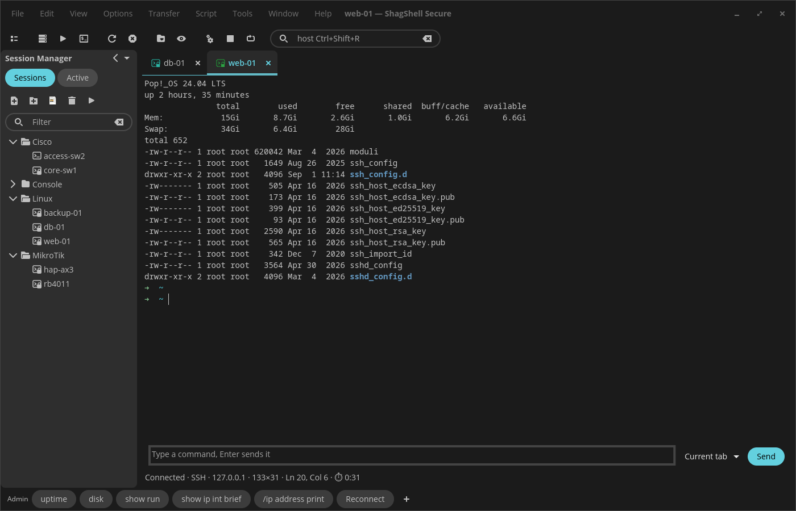
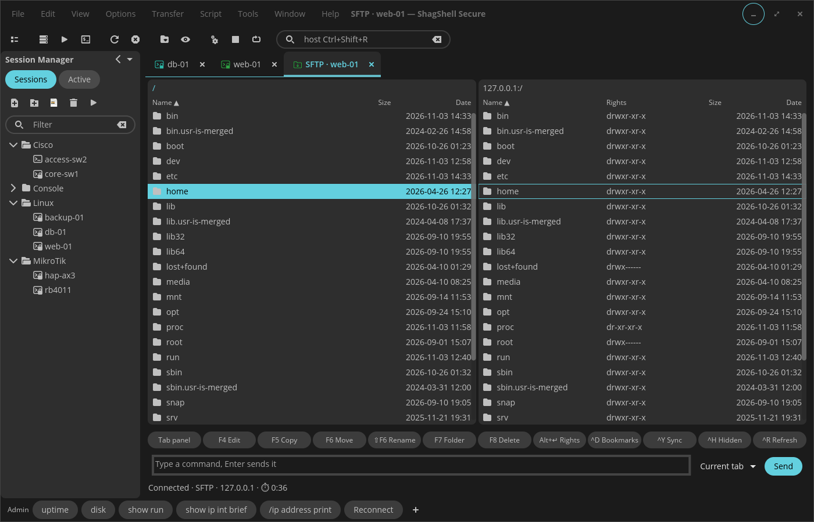
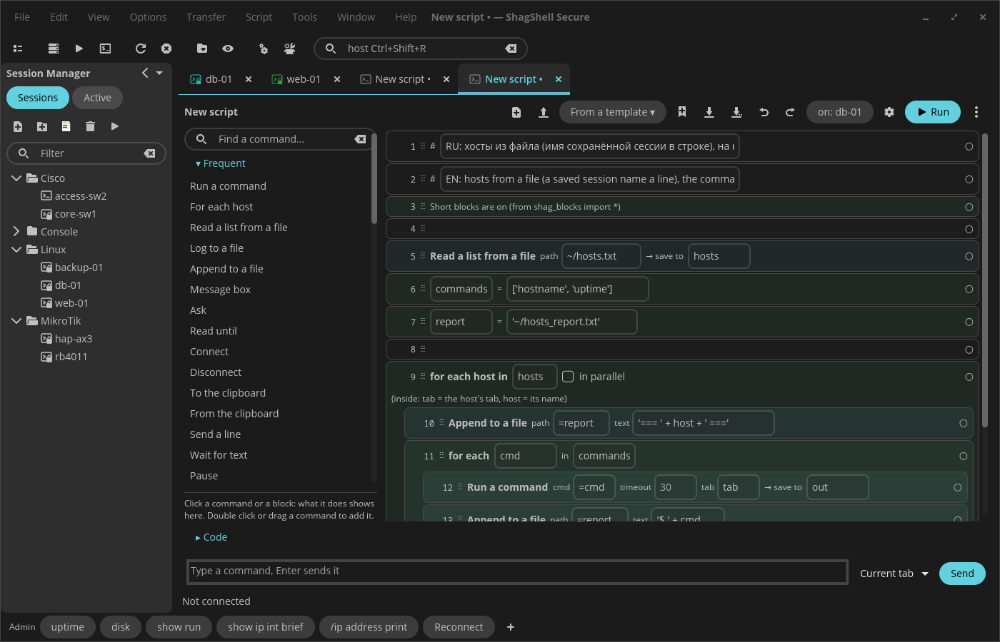
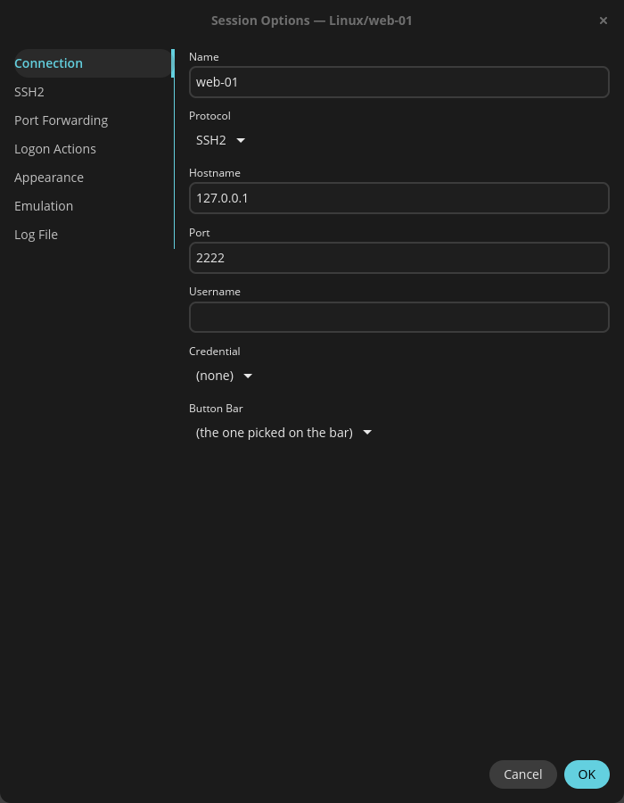

# ShagShell Secure

[English](README.md) | Русский

Менеджер SSH / SFTP / Telnet / serial-сессий для рабочего стола COSMIC (Pop!_OS 24.04) в духе SecureCRT для Windows. Написан на Rust на [libcosmic](https://github.com/pop-os/libcosmic). Для Linux-серверов и сетевого оборудования (Cisco, MikroTik, …).



**Статус:** активная разработка, используется каждый день.

## Возможности

- **Менеджер сессий** как в SecureCRT: дерево папок и сессий, фильтр, сортировка перетаскиванием, страница «Активные» с открытыми; быстрое подключение (Alt+Q), панель подключения (Ctrl+Shift+R), локальный shell (Ctrl+Shift+T)
- **Внутри — системный OpenSSH**: `~/.ssh/config`, ключи, агент, jump-хосты, проброс портов, ControlMaster (SFTP и клоны вкладок идут по уже открытому соединению) работают сами
- **Пароли и наборы учётных данных — в связке ключей** (Secret Service), никогда в файлах; запросы пароля и ключа хоста — в собственных окнах программы
- **Вкладки и группы вкладок** рядом друг с другом, перенос вкладки в другую группу или в отдельное окно, группы сессий открываются разом
- **Вкладка SFTP** в стиле SecureFX: две панели, F5 копировать / F6 переместить / F7 папка / F8 удалить, очередь передач с ответами на конфликты, синхронизация папок (Ctrl+Y), закладки, права
- **Командное окно**: набрать один раз и отправить в текущую вкладку, группу или во все; многострочный ввод
- **Панель кнопок**: именованные панели с кнопками, которые отправляют строку, вызывают функцию меню, программу или скрипт; импорт из SecureCRT
- **Telnet, serial** (picocom) и **X/Y/Zmodem** (lrzsz, приём Zmodem сам)
- **Действия при входе** (expect / send), подсветка ключевых слов, цветовые схемы, назначение клавиш, журналы сессий по шаблонам имён
- **Скрипты на Python** с объектом `crt` как в SecureCRT (`crt.Screen.Send`, `WaitForString`, диалоги, `crt.FileTransfer`…), короткие блоки вроде `run('show version')`, запись скрипта, консоль и отладка, планировщик
- **Конструктор скриптов**: скрипт из блоков («Для каждого хоста», «Выполнить команду», «Дописать в файл»…), рядом его код на Python, запуск с подсветкой текущего шага
- **Импорт из SecureCRT**: сессии вместе с папками, панель кнопок, Command Manager, цветовые схемы; хосты из `~/.ssh/config` тоже
- Заметки (вкладки `.md`), создание SSH-ключей и загрузка на сервер, подписанные обновления, английский и русский интерфейс

## Поближе

| | |
|---|---|
|  |  |
| Вкладка SFTP: две панели, F-клавиши, очередь, синхронизация | Конструктор скриптов: блоки и Python за ними |



Параметры сессии, как в SecureCRT: подключение, SSH2, проброс портов, действия при входе, внешний вид, эмуляция, журнал

Скриншоты — с английским интерфейсом; язык переключается в «Сервис → Общие параметры…».

## Клавиши

| | |
|---|---|
| Alt+M | Менеджер сессий |
| Alt+C / Alt+Q | Подключиться… / Быстрое подключение |
| Alt+P | Вкладка SFTP для активной сессии |
| Ctrl+Shift+R | Панель подключения: введите хост или имя сессии |
| Ctrl+Shift+T | Локальный shell |
| Ctrl+Shift+M | Скрыть / показать главное меню |
| F4 / F5 / F6 / F7 / F8 | SFTP: правка / копировать / переместить / новая папка / удалить |
| Ctrl+Y / Ctrl+D / Ctrl+H | SFTP: синхронизация папок / закладки / скрытые файлы |

Свои клавиши на строки, функции меню, программы и скрипты: «Сервис → Назначение клавиш…». Ctrl+Insert и Shift+Insert оставлены системе.

## Установка

### .deb (Pop!_OS 24.04, Ubuntu 24.04)

Скачать последний релиз в текущую папку, проверить и установить — скопируйте весь блок, больше ничего не нужно (файлы берутся только из этого репозитория):

```sh
B=https://github.com/shagovAlexei/cosmic-ext-shagshell-secure/releases/latest/download
curl -fLO $B/SHA256SUMS
curl -fLO $B/$(awk '{print $2}' SHA256SUMS)
sha256sum -c SHA256SUMS      # должно вывести: shagshell_X.Y.Z_amd64.deb: OK
sudo apt install ./shagshell_*.deb
```

Скачиваете вручную со [страницы релизов](https://github.com/shagovAlexei/cosmic-ext-shagshell-secure/releases/latest)? Сохраните **оба** файла (`.deb` и `SHA256SUMS`) в одну папку и выполните там `sha256sum -c SHA256SUMS`; `No such file` значит, что `SHA256SUMS` не в текущей папке.

Программа проверяет новую версию при запуске (выключается в «Сервис → Общие параметры… → Обновления»). Обновление ставится, только если `SHA256SUMS` подписан ключом автора, встроенным в программу.

`shagshell --check` показывает, что программе нужно: `ssh`, `telnet`, `picocom`, `python3`, `sz` / `rz`, связка ключей.

### Flatpak (репозиторий COSMIC)

Добавляется в [репозиторий flatpak COSMIC](https://github.com/pop-os/cosmic-flatpak). В Pop!_OS 24.04 он уже подключён; в других системах сначала `flatpak remote-add --if-not-exists --user cosmic https://apt.pop-os.org/cosmic/cosmic.flatpakrepo`:

```sh
flatpak install --user cosmic io.github.shagovalexei.ShagShellSecure
```

Во flatpak ssh, SFTP, создание ключей и скрипты работают внутри песочницы со своими OpenSSH и Python; telnet, picocom, lrzsz, локальный shell и кнопки «Запустить программу» запускаются на хосте (`flatpak-spawn --host`), так что их ставьте в систему. Сессии, настройки, журналы и скрипты — те же, что у `.deb` (`~/.config/shagshell`). Системный `/etc/ssh/ssh_config` не читается (ваш `~/.ssh/config` — читается). Обновляет его flatpak; собственная проверка обновлений там выключена.

## Сборка

```sh
just build-release
sudo just install   # или: just deb → target/deb/…deb
just verify         # fmt + clippy + тесты
```

## Поддержать проект

ShagShell Secure бесплатен. Если он вам помогает, можно поддержать — цена одного обеда в McDonald's или пары чашек кофе:

**https://donate.stripe.com/eVqaEYdZz0Ot3bc1F567S05**

Это единственная официальная ссылка для пожертвований (она же в «Справка → Поддержать проект» и в окне обновления). В сборках из других мест может стоять другая.

## Лицензия

GPL-3.0-only. Часть кода адаптирована из [cosmic-term](https://github.com/pop-os/cosmic-term) (GPL-3.0-only).
